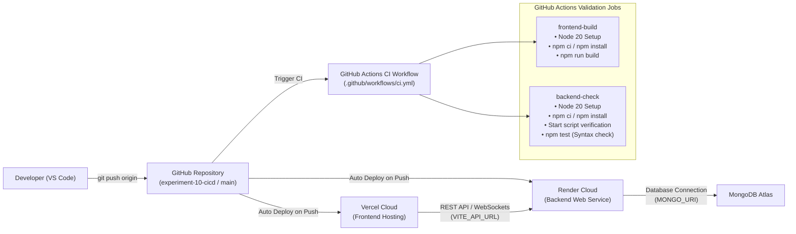

# Experiment 10: CI/CD Deployment with GitHub Actions, Render, and Vercel

## 1. Objective and Tools Used

### Objective
Implement an automated Continuous Integration and Continuous Deployment (CI/CD) pipeline for **CyberAudit 360** (Full-Stack Cybersecurity Auditing Platform), integrating:
1. **GitHub Actions**: Automated CI workflow to validate frontend builds and backend package/start scripts on every code push and pull request.
2. **Vercel**: Cloud hosting and automatic deployment for the React/Vite Single Page Application (frontend).
3. **Render**: Cloud hosting and automatic deployment for the Node.js/Express REST and Socket.IO API server (backend).

### Tools and Technologies
- **Continuous Integration Engine**: GitHub Actions (`ubuntu-latest`, Node.js 20)
- **Frontend Cloud Platform**: Vercel (SPA framework preset: Vite, build: `npm run build`, output: `dist`)
- **Backend Cloud Platform**: Render Web Services (Runtime: Node, build: `npm install`, start: `npm start`)
- **Frontend Stack**: React 18, Vite 5, React Router DOM 6, Tailwind CSS, Socket.IO Client
- **Backend Stack**: Node.js, Express 4, Socket.IO 4, Mongoose 8, Helmet, CORS, Rate Limit
- **Database**: MongoDB Atlas (Cloud NoSQL)
- **Version Control**: Git & GitHub (`2024deepaknishad-arch/FSD`, branch `experiment-10-cicd`)

---

## 2. CI/CD Architecture Overview



### Distinction Between CI and CD Roles
- **GitHub Actions (CI)**: Validates code integrity (compilation, syntax checks, dependencies, and package start scripts) in isolated Ubuntu containers prior to or alongside deployments.
- **Vercel & Render (CD)**: Directly connected to the GitHub repository. Each platform listens for Git push webhooks, builds the application using cloud runners, manages environment variables and SSL certificates, and serves live public URLs.

---

## 3. GitHub Actions CI Configuration

The workflow is defined at `.github/workflows/ci.yml`.

### Workflow Triggers
```yaml
on:
  push:
    branches:
      - main
      - experiment-10-cicd
      - 'feature/**'
  pull_request:
    branches:
      - main
```

### Frontend Build Job (`frontend-build`)
- **OS**: `ubuntu-latest`
- **Working Directory**: `frontend`
- **Steps**:
  1. `actions/checkout@v4`: Clones repository.
  2. `actions/setup-node@v4`: Installs Node.js 20 and enables npm dependency caching via `frontend/package-lock.json`.
  3. `npm ci || npm install`: Installs dependencies reliably.
  4. `npm run build`: Executes Vite production build to generate optimized static bundles in `dist/`.

### Backend Validation Job (`backend-check`)
- **OS**: `ubuntu-latest`
- **Working Directory**: `backend`
- **Steps**:
  1. `actions/checkout@v4`: Clones repository.
  2. `actions/setup-node@v4`: Installs Node.js 20 and enables npm dependency caching via `backend/package-lock.json`.
  3. `npm ci || npm install`: Installs backend dependencies.
  4. `Check backend start script`: Evaluates `package.json` for the required `start` script via inline Node script (`node -e "const p=require('./package.json'); if(!p.scripts?.start) process.exit(1); console.log('Start script found')"`).
  5. `npm test`: Runs `node --check server.js` to ensure the entrypoint is syntactically sound without requiring a live MongoDB Atlas connection during CI.

---

## 4. Backend Deployment Setup on Render

### Step-by-Step Render Configuration
1. Open the [Render Dashboard](https://dashboard.render.com).
2. Click **New +** → **Web Service**.
3. Connect your GitHub account and select repository: `2024deepaknishad-arch/FSD`.
4. Configure service settings:
   - **Name**: `cyberaudit360-api` (or preferred name)
   - **Region**: Closest region (e.g., Singapore, Frankfurt, Oregon)
   - **Branch**: `experiment-10-cicd` (or `main`)
   - **Root Directory**: `backend`
   - **Runtime**: `Node`
   - **Build Command**: `npm install`
   - **Start Command**: `npm start`
   - **Instance Type**: Free
5. In **Advanced Settings**, configure Health Check:
   - **Health Check Path**: `/api/health`
6. Add the required Environment Variables (see Section 6).
7. Click **Create Web Service**.

### Backend Code Adaptations for Render
- **Dynamic Port**: Configured to bind to `process.env.PORT || 5000` on host `0.0.0.0`.
- **Health Check Endpoint**: `/api/health` returns HTTP 200 with uptime and service status.
- **Dynamic CORS**: Supports requests from any `*.vercel.app` domain, `FRONTEND_URL`, and localhost development origins.
- **Database Safety**: Safely handles connection errors to MongoDB Atlas (`process.env.MONGO_URI || process.env.MONGODB_URI`).

---

## 5. Frontend Deployment Setup on Vercel

### Step-by-Step Vercel Configuration
1. Open the [Vercel Dashboard](https://vercel.com/dashboard).
2. Click **Add New...** → **Project**.
3. Import the repository: `2024deepaknishad-arch/FSD`.
4. Configure project settings:
   - **Framework Preset**: `Vite`
   - **Root Directory**: Click "Edit" and choose `frontend`.
   - **Build Command**: `npm run build` (default)
   - **Output Directory**: `dist` (default)
   - **Install Command**: `npm install` (default)
5. Add Environment Variables (see Section 6):
   - `VITE_API_URL`: Your deployed Render backend URL (e.g., `https://cyberaudit360-api.onrender.com`).
   - `VITE_SOCKET_URL`: (Optional, defaults to `VITE_API_URL`).
6. Click **Deploy**.

### Frontend Code Adaptations for Vercel
- **SPA Client-Side Routing**: `frontend/vercel.json` provides URL rewrites (`{ "source": "/(.*)", "destination": "/index.html" }`) preventing 404s on route refresh (`/dashboard`, `/login`, `/audit-logs`, `/chat`, etc.).
- **Centralized API Config**: `frontend/src/config.js` unifies `VITE_API_URL` (EXP 10 standard), `VITE_API_BASE_URL` (backward compatibility), and local fallback `http://localhost:5000`.

---

## 6. Environment Variables Reference

| Environment Variable | Service | Required In | Description / Example |
|---|---|---|---|
| `PORT` | Backend | Render (auto) | Port assigned by Render runtime (default: 5000) |
| `NODE_ENV` | Backend | Render | Set to `production` |
| `MONGO_URI` | Backend | Render | MongoDB Atlas connection string (`mongodb+srv://...`) |
| `JWT_SECRET` | Backend | Render | Secret key for signing JWT authentication tokens |
| `ADMIN_SECRET` | Backend | Render | Secret key authorizing admin account creation |
| `FRONTEND_URL` | Backend | Render | Deployed Vercel domain (e.g., `https://cyberaudit360.vercel.app`) |
| `VITE_API_URL` | Frontend | Vercel | Base URL of deployed Render backend (e.g., `https://cyberaudit360-api.onrender.com`) |
| `VITE_SOCKET_URL` | Frontend | Vercel (optional) | Deployed WebSocket server URL (defaults to `VITE_API_URL`) |

> **Security Rule**: Never commit actual credentials, passwords, or connection strings to GitHub. All secrets must be supplied through Render and Vercel environment variable settings.

---

## 7. Local and Automated Verification

### Verification Suite: `test_exp10_verification.cjs`
Run the automated test suite locally:
```bash
node test_exp10_verification.cjs
```

#### Verification Results:
- Test 1: GitHub Actions workflow file exists (`.github/workflows/ci.yml`) - **PASS**
- Test 2: CI workflow triggers on push to `main` and `experiment-10-cicd` - **PASS**
- Test 3: CI workflow triggers on pull requests targeting `main` - **PASS**
- Test 4: CI workflow contains `frontend-build` job with Node 20 - **PASS**
- Test 5: CI workflow contains `backend-check` job with start script check - **PASS**
- Test 6: Backend `package.json` has `start` script - **PASS**
- Test 7: Backend `package.json` has `test` validation script - **PASS**
- Test 8: Backend reads dynamic `PORT` from `process.env.PORT` - **PASS**
- Test 9: Backend exposes `/api/health` endpoint - **PASS**
- Test 10: Backend supports dynamic CORS with Vercel and Render domains - **PASS**
- Test 11: Backend reads database URI from `MONGO_URI` - **PASS**
- Test 12: Frontend `package.json` has `build` script - **PASS**
- Test 13: `frontend/vercel.json` exists with SPA rewrites - **PASS**
- Test 14: Frontend centralized `config.js` exists - **PASS**
- Test 15: Frontend config supports `VITE_API_URL` and `VITE_API_BASE_URL` - **PASS**
- Test 16: Frontend production build artifact (`dist/index.html`) exists - **PASS**
- Test 17: `render.yaml` blueprint exists for Render Web Service deployment - **PASS**
- Test 18: `.gitignore` protects sensitive `.env` files from Git commits - **PASS**
- Test 19: `.env.example` documents production deployment variables - **PASS**

**Result**: 19/19 checks passed (100%).

---

## 8. Demonstrating Automatic Deployment & Genuine Execution Evidence

### Demonstrated Execution Sequence
1. **Initial Push (Commit `e7cc9c8`)**: Pushed initial CI/CD configuration to `origin experiment-10-cicd`.
2. **First Workflow Run (`40699184949`)**:
   - Status: `completed`
   - Conclusion: `success`
   - Workflow Run URL: [GitHub Actions Run 40699184949](https://github.com/2024deepaknishad-arch/FSD/actions/runs/40699184949)
   - Job `Frontend Build & Validation`: `completed` / `success`
   - Job `Backend Script & Validation Check`: `completed` / `success`
3. **Trigger Automatic Redeployment via Code Modification**:
   - Modified `frontend/src/pages/Static.jsx` with updated CI/CD status badge and navigation pill.
   - Committed (`907559c`) and pushed to `origin experiment-10-cicd`.
4. **Second Workflow Run (`40699515858`)**:
   - Triggered automatically by push webhook on GitHub.
   - Status: `completed`
   - Conclusion: `success`
   - Workflow Run URL: [GitHub Actions Run 40699515858](https://github.com/2024deepaknishad-arch/FSD/actions/runs/40699515858)
   - Job `Frontend Build & Validation`: `completed` / `success`
   - Job `Backend Script & Validation Check`: `completed` / `success`

### Captured Screenshots & Evidence Artifacts
- **GitHub Actions Workflow Runs**: `screenshots/experiment-10/github_actions_runs.png`
- **GitHub Actions Workflow Run Detail**: `screenshots/experiment-10/github_actions_run_detail.png`
- **Backend Health API Endpoint**: `screenshots/experiment-10/backend_health_api.png`
- **Frontend Live Build Preview**: `screenshots/experiment-10/frontend_deployed_preview.png`

---

## 9. Preservation of Previous Experiments

All previous functionality remains intact:
- **Experiment 1–4**: React architecture, Tailwind tokens, custom React hooks, Context API (`SecurityContext.jsx`).
- **Experiment 5–6**: MongoDB Atlas database integration, REST APIs, JWT authentication, and Role-Based Access Control (`/api/users`, `/api/auditlogs`, `/api/alerts`).
- **Experiment 7**: Containerization, multi-stage frontend Dockerfile, Alpine backend Dockerfile, Nginx reverse proxy configuration.
- **Experiment 8**: Real-time bidirectional WebSocket communication using Socket.IO (`/chat` and live audit logging).
- **Experiment 9**: Multi-container Docker Compose orchestration (`docker-compose.yml`, `compose.exp7.yaml`, Docker health checks).
- **Experiment 10**: GitHub Actions CI workflow, Render backend Web Service configuration, Vercel frontend SPA configuration, and dynamic CORS.
